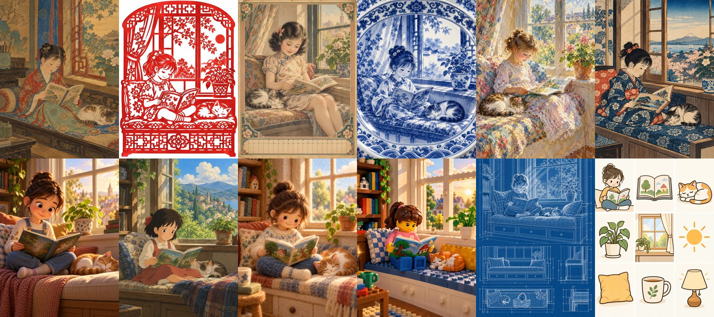

# GPT Image Style Atlas

**One scene, 116 art styles.** A side-by-side style reference for GPT Image 2, with copy-ready prompts.

[中文说明](README.zh-CN.md) · [Live site](https://acesjohnny.github.io/gpt-image-style-atlas/) · [All 116 cards](styles/README.md)



Every card renders the same subject — *a seven-year-old child reading a picture book on a window seat, a cat asleep beside them, afternoon light* — so the only thing that changes is the style. That makes it easy to see what "gongbi", "1930s Shanghai calendar poster", "risograph" or "needle-felted wool" actually look like before you put them in a prompt.

## What's inside

| Path | What it is |
|---|---|
| [`styles/`](styles/README.md) | 116 style cards in 9 groups: Chinese traditional, Republic-era & modern Chinese, hand-drawn, painting movements, printmaking, cartoon & anime, 3D & handmade materials, photography & film, design & diagrams |
| [`styles/prompts.md`](styles/prompts.md) | The full prompt for every card |
| [`styles/styles.json`](styles/styles.json) | Same data, machine-readable |
| [`docs/techniques.md`](docs/techniques.md) | 17 advanced prompting techniques (Chinese), distilled from ~600 public GPT Image 2 cases, with links to the originals |
| [`docs/case-index.md`](docs/case-index.md) | Title / author / link index of 626 public cases (links only — no images or prompts are copied) |
| [`tools/generate.py`](tools/generate.py) | Batch generator: renders every style through the Codex CLI image tool, resumable, stops on quota |
| [`index.html`](index.html) | The browsable atlas (search, filter by group, click to copy prompts) |

## Reuse a style

Copy a style description from any card and swap in your own subject:

```text
Style: <style description>.
Subject: <your subject>.
Render the whole image faithfully in this one style.
```

## Regenerate the cards

```bash
python3 tools/generate.py --workers 3
```

Needs the [Codex CLI](https://github.com/openai/codex) signed in to a ChatGPT plan with image generation. The image quota is separate from the text quota; on a Plus plan expect roughly 70 images before it runs out. The script skips finished images, so just run it again after the reset.

## Related

Turning still images into video? See **[keyframe-video-skill](https://github.com/acesjohnny/keyframe-video-skill)** — an agent skill for keyframe-driven AI video production.

## License

Code: MIT. Style-card images and written content: CC BY 4.0. Style names that mention an artist or studio are style references only; this project is not affiliated with them. Cases in `docs/case-index.md` belong to their creators.
